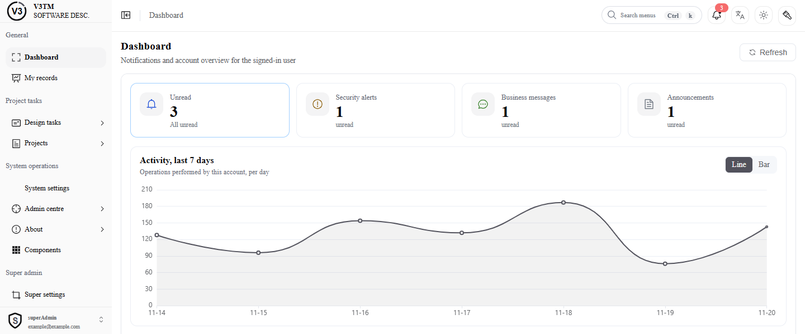
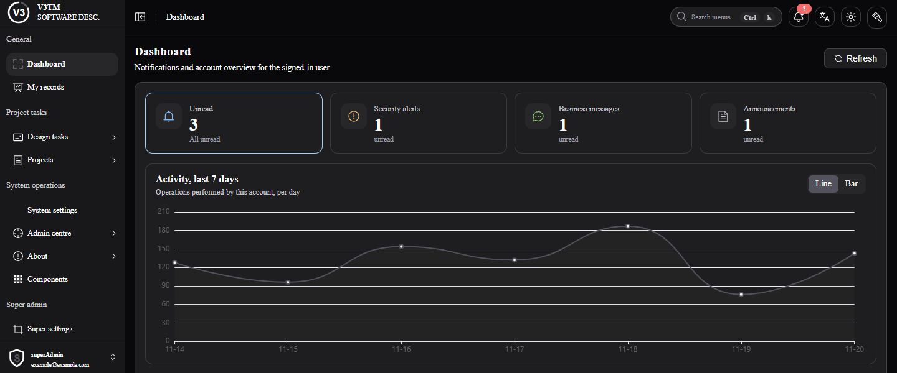
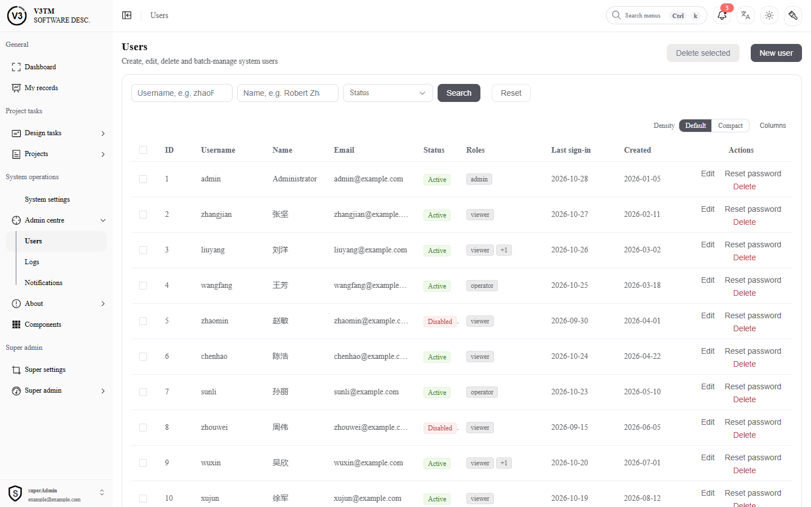
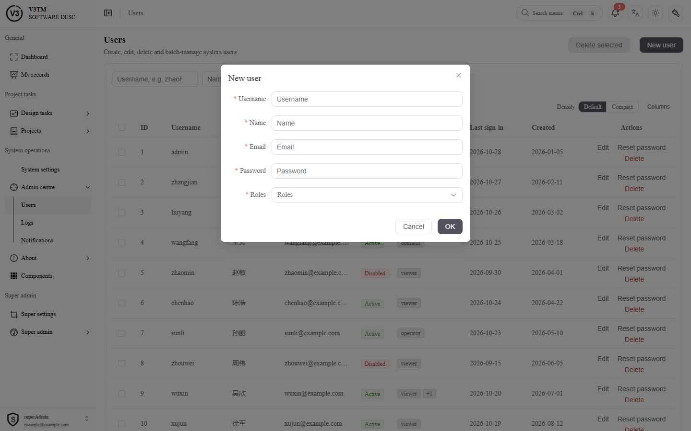
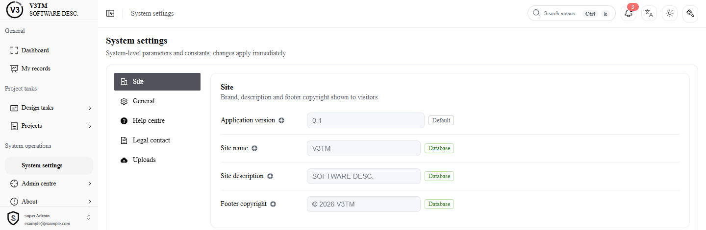
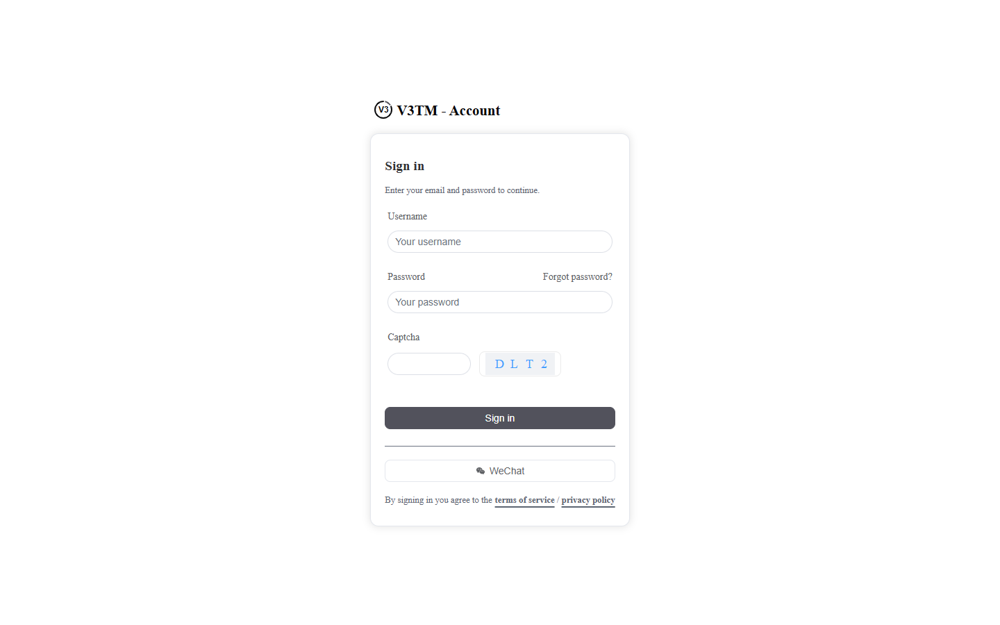
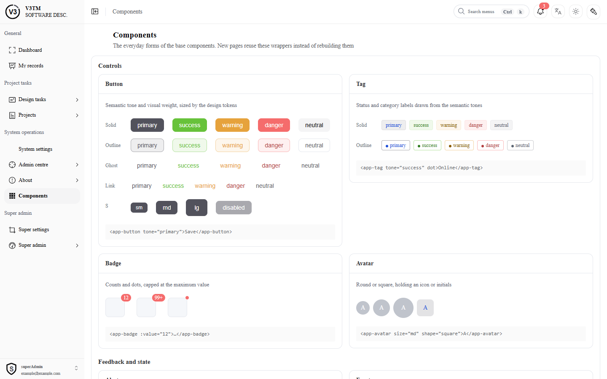
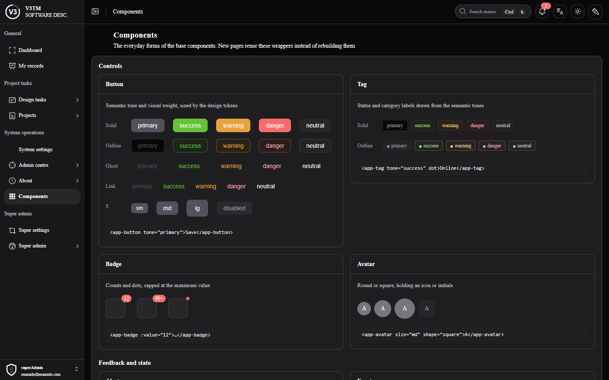

# V3TM — Enterprise Admin Template for Vue 3

[简体中文](README.md) | English

An admin front-end template built with Vue 3, TypeScript and Vite. It ships dynamic routing, RBAC, design tokens, a complete mock layer, and working pages for users, roles, menus, permissions, notifications, logs, settings and a knowledge base — a starting point for internal tools rather than a demo.

[](https://github.com/GooHvLiu/V3TM/releases)[](LICENSE)[](https://github.com/GooHvLiu/V3TM/actions/workflows/ci.yml)[](https://github.com/GooHvLiu/V3TM/actions/workflows/docs.yml)[](https://vuejs.org)[](https://vite.dev)[](https://www.typescriptlang.org)[](https://element-plus.org)[](https://nodejs.org)[](CONTRIBUTING.md)

Documentation: https://goohvliu.github.io/V3TM/ · Live demo: https://goohvliu.github.io/V3TM/demo-app/

## Demo account

The live demo and local mock mode share the same preset account. The captcha is four letters and digits; type what the image shows.

| Account      | Password            | Role        |
| ------------ | ------------------- | ----------- |
| `superAdmin` | `superAdmin123456@` | Super admin |
| `admin`      | `admin123456@`      | Admin       |

`admin` signs in with the regular admin role, which carries fewer menus and permissions than the super admin — useful for comparing the two. The mock layer matches the account by username and checks its status only; the password and captcha are not verified. With a real backend, authentication is the backend's job.

## Preview

Light and dark themes share one token set; charts, cards and tables follow the active theme. Screenshots live per language: `docs/images/en` here, `docs/images/zh` for the Chinese README.

| Dashboard · light                                                                                      | Dashboard · dark                                                                                     |
| ------------------------------------------------------------------------------------------------------ | ---------------------------------------------------------------------------------------------------- |
|              |              |
| **List page · ProTable**                                                                               | **Form dialog · ProForm**                                                                            |
|                                       |                             |
| **Settings · grouped parameters**                                                                      | **Sign in**                                                                                          |
|                              |                                  |
| **Components · light**                                                                                 | **Components · dark**                                                                                |
|  |  |

Screenshots are taken with the English locale in mock mode. Sample records keep Chinese names, matching the data set the template ships with.

## Quick start

Requires Node.js >= 22 and npm >= 10.

```bash
npm install
cp .env.example .env.development
npm run dev
```

Open `http://localhost:5173`. Mock mode is controlled by `VITE_USE_MOCK` in `.env.development`; point `VITE_APP_PROXY_TARGET` at your backend to use real APIs.

```bash
npm run build
npm run preview
```

Docs site:

```bash
npm run docs:dev
```

`docs-site/` is a standalone VitePress site with five sections: guide, common components, business components, reference and a playground that embeds the running app. Examples import the real components from `src`, so editing a component updates the docs.

To run the app and the docs side by side, change the port with `npm run dev -- --port 5174` and set `VITE_DEMO_APP_URL` accordingly.

Build the combined static site:

```bash
npm run site:build
npm run site:preview -- --port 4180
```

`site:build` builds the app in mock mode, mounts it under `demo-app/`, and merges everything into `dist-site/`, ready to upload to any static host.

## What is included

| Area        | Implementation                                                                                                                                                                                      |
| ----------- | --------------------------------------------------------------------------------------------------------------------------------------------------------------------------------------------------- |
| Stack       | Vue 3.5, Vite 8, TypeScript 6, Element Plus, Pinia, Vue Router, vue-i18n                                                                                                                            |
| Routing     | Menu-driven dynamic routes from the backend; directory, menu and button nodes; deep-link fallback                                                                                                   |
| Permissions | Route guards plus a `v-permission` directive for button-level checks; codes come from the profile payload                                                                                           |
| Requests    | Axios wrapper with single-flight token refresh, queued replay, unified error codes, mock adapter                                                                                                    |
| State       | Modular Pinia stores split by domain: user, menu, theme, notification, config                                                                                                                       |
| i18n        | Complete Chinese and English packs, switchable from the header; preferences persisted locally                                                                                                       |
| Theme       | CSS variables plus Less tokens; light, dark and brand colour are switchable at runtime                                                                                                              |
| Mock        | Menus, users, roles, dictionaries, notifications, logs, help and metrics are all mocked                                                                                                             |
| Pages       | User, role, menu, permission, notification, log and session centres; system settings; help centre; knowledge base                                                                                   |
| Tooling     | Apache-2.0, ESLint with accessibility rules (0 warnings), Prettier, Vitest with a coverage floor, Playwright smoke tests, Git hooks, a ten-step GitHub Actions gate and production dependency audit |

## Layout

```text
V3TM/
├─ src/
│  ├─ api/            API modules grouped by domain
│  ├─ assets/         icons, images, Less styles and tokens
│  ├─ components/     components grouped by domain
│  ├─ composables/    table, request and other composables
│  ├─ constants/      route, storage and configuration constants
│  ├─ directives/     the v-permission directive
│  ├─ layout/         app shell, sidebar and header
│  ├─ locales/        i18n packs
│  ├─ mocks/          mock data and request dispatching
│  ├─ pages/          pages grouped by domain
│  ├─ router/         static routes, dynamic routes and guards
│  ├─ stores/         Pinia modules
│  ├─ types/          hand-written TypeScript types
│  └─ utils/          request, storage, permission and formatting helpers
├─ docs/              design rules and repository images
├─ docs-site/         VitePress site: guide, components, business components, reference, playground
├─ e2e/               Playwright end-to-end tests
├─ public/            static assets
├─ scripts/           build helpers and guards
├─ .github/           issue and PR templates, CI
├─ .env.example       environment template
├─ vite.config.ts     Vite configuration
└─ package.json
```

## Scripts

| Command                    | Purpose                                                                                                               |
| -------------------------- | --------------------------------------------------------------------------------------------------------------------- |
| `npm run dev`              | Development server                                                                                                    |
| `npm run build`            | Type check and production build                                                                                       |
| `npm run preview`          | Preview the build output                                                                                              |
| `npm run lint`             | ESLint                                                                                                                |
| `npm run lint:fix`         | ESLint with fixes                                                                                                     |
| `npm run format`           | Prettier                                                                                                              |
| `npm run format:check`     | Prettier check only                                                                                                   |
| `npm run type-check`       | vue-tsc type check                                                                                                    |
| `npm run type-check:docs`  | Type check the docs site theme sources                                                                                |
| `npm run test`             | Vitest in watch mode                                                                                                  |
| `npm run test:run`         | Vitest once                                                                                                           |
| `npm run test:coverage`    | Unit tests with coverage, fails below the floor                                                                       |
| `npm run test:e2e`         | Playwright end-to-end smoke tests (system Chrome locally, downloaded chromium in CI)                                  |
| `npm run test:e2e:install` | Install chromium before the first e2e run                                                                             |
| `npm run audit`            | Dependency audit including dev dependencies, official registry                                                        |
| `npm run audit:prod`       | Production dependencies only, fails on high severity, used by CI                                                      |
| `npm run audit:offline`    | Audit from the local cache                                                                                            |
| `npm run primitives:check` | Guard against misuse of the primitive layer                                                                           |
| `npm run spacing:check`    | Guard that spacing comes from tokens                                                                                  |
| `npm run contrast:check`   | Contrast baseline for both themes                                                                                     |
| `npm run bundle:check`     | First-screen budget of 920 kB                                                                                         |
| `npm run verify`           | Ten steps: lint, primitive guard, spacing guard, contrast, types, docs types, tests, build, bundle budget, docs build |
| `npm run docs:dev`         | Docs site in development                                                                                              |
| `npm run docs:build`       | Build the docs site                                                                                                   |
| `npm run docs:preview`     | Preview the docs build                                                                                                |
| `npm run site:build`       | Build docs and the mock app into `dist-site/`                                                                         |
| `npm run site:preview`     | Preview `dist-site/` with SPA fallback                                                                                |
| `npm run sync:vditor`      | Sync the Vditor static assets                                                                                         |

`docs:*` and `site:*` perform real builds; `type-check:docs` checks the docs theme and configuration and is part of `verify`.

## Environment

Copy `.env.example` to a local env file and adjust as needed:

| Variable                   | Meaning                                      |
| -------------------------- | -------------------------------------------- |
| `VITE_APP_LOCALE`          | Default language                             |
| `VITE_STORAGE_TYPE`        | Local storage type                           |
| `VITE_APP_BASE_API`        | API prefix                                   |
| `VITE_APP_TIME_OUT`        | Request timeout                              |
| `VITE_USE_MOCK`            | Enable the mock layer                        |
| `VITE_APP_PROXY_TARGET`    | Development proxy target                     |
| `VITE_APP_PORT`            | Development port                             |
| `VITE_APP_BASE`            | Build base, set when deploying to a sub path |
| `VITE_DEMO_APP_URL`        | App URL embedded by the docs site            |
| `VITE_APP_HELP_AI_TIMEOUT` | Help centre AI request timeout               |

When `VITE_USE_MOCK` is unset, the mode follows the run target: development and e2e use the mock layer, a production build talks to the real API.

## Documentation

- [Component docs](docs-site/index.md): guide, 14 common components, 4 business components, spacing tokens and breakpoints
- [Primitive layer rules](docs/design/ep-primitives.md): where wrapping Element Plus stops
- [Changelog](CHANGELOG.md)

## Contributing

Run `npm run verify` before opening a pull request; also run `npm run test:e2e` when the change touches the sign-in page or theme tokens. Branch naming, commit messages and documentation expectations are in [CONTRIBUTING.md](CONTRIBUTING.md). Bugs and ideas go through the issue templates; security reports follow [SECURITY.md](SECURITY.md) and must not be filed as public issues.

## Environment and tooling

- `.nvmrc` pins the same Node version CI uses; `nvm use` is enough
- `.editorconfig` keeps indentation and line endings consistent across editors
- Dependabot opens updates on a schedule — npm dependencies weekly, GitHub Actions monthly — and skips major bumps, so Element Plus and Vite are not dragged along

## License

Apache License 2.0. See [LICENSE](LICENSE); `package.json` declares `Apache-2.0`, copyright `Copyright 2026 GooHv`.

Third-party packages keep their own licenses; check them individually before use.
