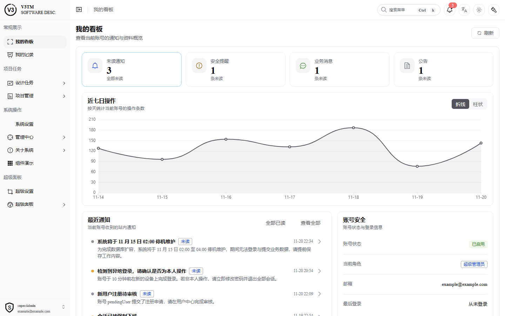
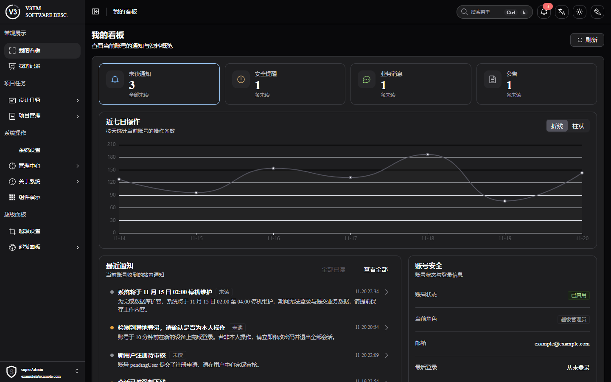
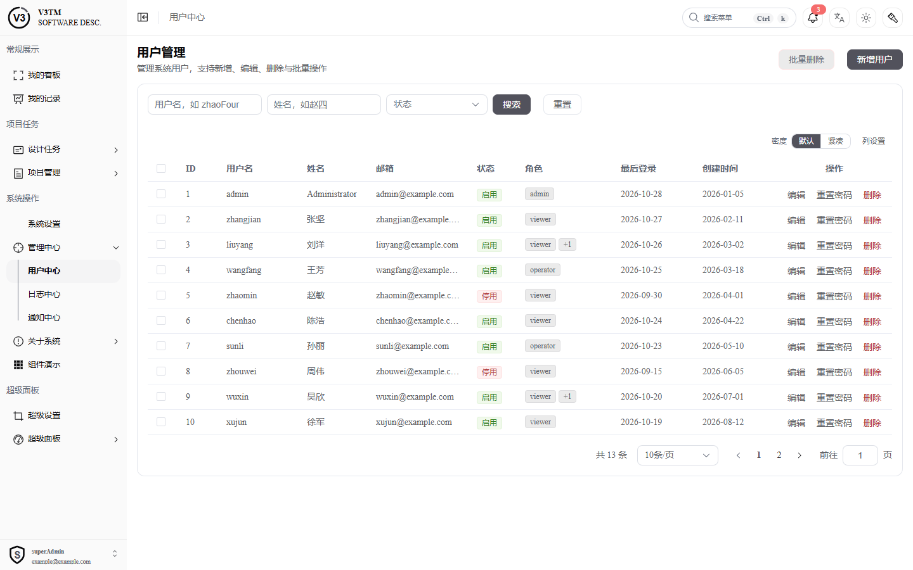
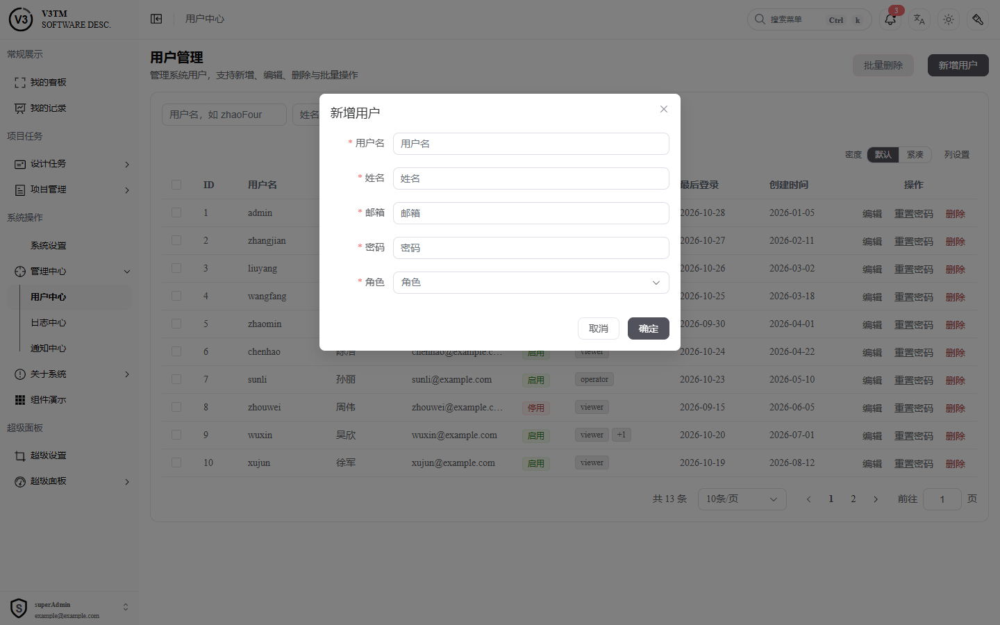
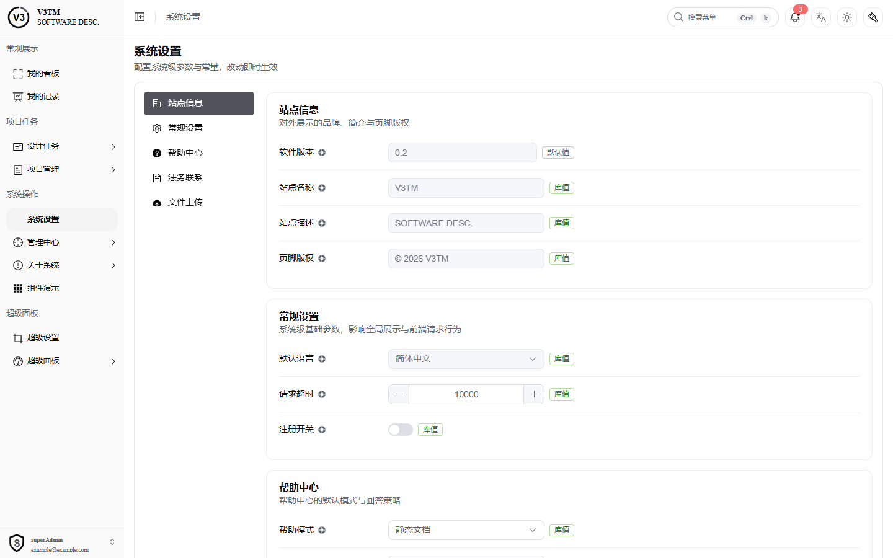
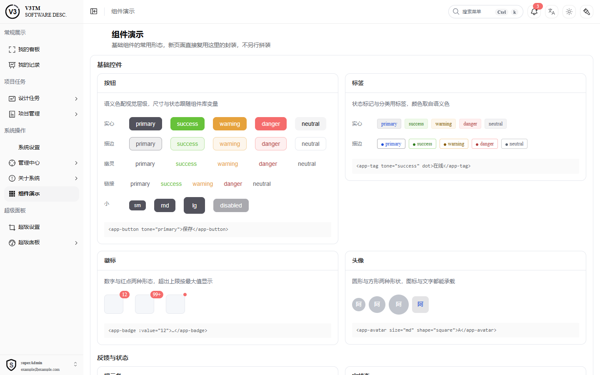
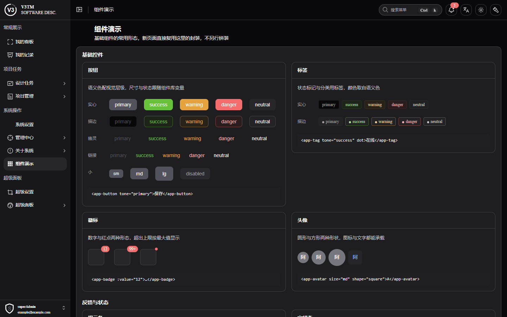

# V3TM 企业级中后台前端模板

简体中文 | [English](README.en.md)

Vue 3 + TypeScript + Vite 的中后台前端模板，内置动态路由、RBAC 权限、主题令牌、Mock 接口、通知/日志/知识库等业务页面，适合作为企业后台项目的起点。

[](https://github.com/GooHvLiu/V3TM/releases)[](LICENSE)[](https://github.com/GooHvLiu/V3TM/actions/workflows/ci.yml)[](https://github.com/GooHvLiu/V3TM/actions/workflows/docs.yml)[](https://vuejs.org)[](https://vite.dev)[](https://www.typescriptlang.org)[](https://element-plus.org)[](https://nodejs.org)[](CONTRIBUTING.md)

在线文档：https://goohvliu.github.io/V3TM/ ｜ 在线演示：https://goohvliu.github.io/V3TM/demo-app/

## 演示账号

在线演示与本地 Mock 模式共用同一套预置账号，验证码是 4 位字母数字，按图中字符输入即可。

| 账号         | 密码                | 角色       |
| ------------ | ------------------- | ---------- |
| `superAdmin` | `superAdmin123456@` | 超级管理员 |
| `admin`      | `admin123456@`      | 管理员     |

`admin` 是普通管理员视角，菜单与按钮权限比超管少一截，可用来对照 RBAC。Mock 层按用户名匹配账号并校验账号状态，不校验密码与验证码；接入真实后端后，认证交由后端处理。

## 界面预览

浅色与深色两套主题共用同一套令牌，图表、卡片、表格随主题切换。截图按语言分目录存放，`docs/images/zh` 与 `docs/images/en` 各一套。

| 看板 · 浅色                                                                        | 看板 · 深色                                                                       |
| ---------------------------------------------------------------------------------- | --------------------------------------------------------------------------------- |
|      |      |
| **列表页 · ProTable**                                                              | **表单弹窗 · ProForm**                                                            |
|                |                |
| **系统设置 · 参数分组**                                                            | **登录页**                                                                        |
|                 |                     |
| **组件演示 · 浅色**                                                                | **组件演示 · 深色**                                                               |
|  |  |

截图取自 Mock 模式，页面内数据均为示例。

## 30 秒上手

环境要求：Node.js >= 22、npm >= 10。

```bash
npm install
cp .env.example .env.development
npm run dev
```

默认地址 `http://localhost:5173`。Mock 开关由 `.env.development` 的 `VITE_USE_MOCK` 控制；接后端时填 `VITE_APP_PROXY_TARGET`。

```bash
npm run build
npm run preview
```

文档站：

```bash
npm run docs:dev
```

`docs-site/` 是独立的 VitePress 站，分五块：指南（快速开始、目录分层、环境与 Mock、路由权限、请求层）、原子组件（14 个带示例与 Props 表）、业务组件（ProTable / ProForm / ProSearch / BaseChart）、参考（间距令牌、断点）、演示（内嵌本机应用）。示例直接 import `src/components` 下的真实组件，改组件即改文档。

与应用同时启动时改端口：`npm run dev -- --port 5174`，再把 `VITE_DEMO_APP_URL` 指到新端口。

构建合并静态站：

```bash
npm run site:build
npm run site:preview -- --port 4180
```

`site:build` 以 Mock 模式构建应用并挂到 `demo-app/` 子路径，产物合并到 `dist-site/`，可直接上传到静态站点服务。

## 能力矩阵

| 能力   | 当前实现                                                                                                                                      |
| ------ | --------------------------------------------------------------------------------------------------------------------------------------------- |
| 技术栈 | Vue 3.5、Vite 8、TypeScript 6、Element Plus、Pinia、Vue Router、vue-i18n                                                                      |
| 路由   | 后端菜单驱动动态路由，支持目录/菜单/按钮节点与深链兜底                                                                                        |
| 权限   | 路由守卫 + `v-permission` 按钮级权限，权限码从 profile 下发                                                                                   |
| 请求层 | Axios 封装、单飞续期、失败排队重放、统一错误码与 Mock 适配                                                                                    |
| 状态   | Pinia 模块化 store，用户/菜单/主题/通知/配置按域拆分                                                                                          |
| 国际化 | 中英双语言包完整，顶栏可切换；语言与主题偏好本地持久化                                                                                        |
| 主题   | CSS 变量 + Less 令牌，亮色/暗色/主题色可切换                                                                                                  |
| Mock   | 菜单、用户、角色、字典、通知、日志、帮助、指标等接口内置 Mock                                                                                 |
| 业务页 | 用户中心、角色中心、菜单中心、权限中心、通知中心、日志中心、系统设置、帮助中心、知识库                                                        |
| 工程   | Apache-2.0、ESLint（含无障碍规则，当前 0 警告）、Prettier、Vitest 与覆盖率门槛、Playwright 冒烟、Git hooks、GitHub Actions 门禁与生产依赖审计 |

## 目录

```text
V3TM/
├─ src/
│  ├─ api/            接口模块，按业务域分目录
│  ├─ assets/         图标、图片、Less 样式与主题令牌
│  ├─ components/     按业务域组织的组件
│  ├─ composables/    组合式函数（表格、请求等）
│  ├─ constants/      路由、存储、配置等常量
│  ├─ directives/     自定义指令（v-permission）
│  ├─ layout/         应用壳、侧边栏、顶栏
│  ├─ locales/        i18n 语言包
│  ├─ mocks/          Mock 数据与接口分派
│  ├─ pages/          页面，按后台域分组
│  ├─ router/         静态路由、动态路由、守卫
│  ├─ stores/         Pinia 模块
│  ├─ types/          手写 TypeScript 类型
│  └─ utils/          请求、存储、权限、格式化等工具
├─ docs/              设计约定与中英两套预览图
├─ docs-site/         VitePress 文档站：指南、原子组件、业务组件、参考与演示
├─ e2e/               Playwright 端到端用例
├─ public/            静态资源
├─ scripts/           构建辅助脚本与守卫
├─ .github/           Issue / PR 模板与 CI
├─ .env.example       环境变量样例
├─ vite.config.ts     Vite 配置
└─ package.json
```

## 常用脚本

| 命令                       | 作用                                                                                       |
| -------------------------- | ------------------------------------------------------------------------------------------ |
| `npm run dev`              | 启动开发服务器                                                                             |
| `npm run build`            | 类型检查 + 生产构建                                                                        |
| `npm run preview`          | 预览构建产物                                                                               |
| `npm run lint`             | ESLint 检查                                                                                |
| `npm run lint:fix`         | ESLint 自动修复                                                                            |
| `npm run format`           | Prettier 格式化                                                                            |
| `npm run format:check`     | Prettier 只检查                                                                            |
| `npm run type-check`       | vue-tsc 类型检查                                                                           |
| `npm run type-check:docs`  | 文档站主题源码类型检查                                                                     |
| `npm run test`             | Vitest 监听模式                                                                            |
| `npm run test:run`         | Vitest 单次运行                                                                            |
| `npm run test:coverage`    | 单测并输出覆盖率，低于门槛即失败                                                           |
| `npm run test:e2e`         | Playwright 端到端冒烟（本地用系统 Chrome，CI 用下载的 chromium）                           |
| `npm run test:e2e:install` | 首次跑 e2e 前安装 chromium                                                                 |
| `npm run audit`            | 依赖漏洞审计（含开发依赖，走官方 registry）                                                |
| `npm run audit:prod`       | 只审生产依赖，高危即失败，CI 用这条                                                        |
| `npm run audit:offline`    | 离线审计（使用本地缓存）                                                                   |
| `npm run primitives:check` | 原子层越界用法检查                                                                         |
| `npm run spacing:check`    | 间距是否全部走令牌                                                                         |
| `npm run contrast:check`   | 亮暗两套主题的对比度基线                                                                   |
| `npm run bundle:check`     | 首屏资源体积预算 920 kB                                                                    |
| `npm run verify`           | 十步：lint、原子守卫、间距守卫、对比度、类型、文档站类型、单测、构建、首屏预算、文档站构建 |
| `npm run docs:dev`         | 启动文档站开发服务器                                                                       |
| `npm run docs:build`       | 构建文档站静态产物                                                                         |
| `npm run docs:preview`     | 预览文档站构建产物                                                                         |
| `npm run site:build`       | 构建文档站与 Mock 应用，合并为 `dist-site/`                                                |
| `npm run site:preview`     | 本地预览 `dist-site/`，带单页路由回退                                                      |
| `npm run sync:vditor`      | 同步 Vditor 静态资源                                                                       |

`docs:*` 与 `site:*` 系列脚本都会真实构建；`type-check:docs` 检查文档站主题与配置的类型，已并入 `verify`。

## 环境变量

复制 `.env.example` 为本地环境文件，按需修改：

| 变量                       | 说明                       |
| -------------------------- | -------------------------- |
| `VITE_APP_LOCALE`          | 默认语言                   |
| `VITE_STORAGE_TYPE`        | 本地存储类型               |
| `VITE_APP_BASE_API`        | 接口前缀                   |
| `VITE_APP_TIME_OUT`        | 请求超时                   |
| `VITE_USE_MOCK`            | 是否启用 Mock              |
| `VITE_APP_PROXY_TARGET`    | 开发代理目标               |
| `VITE_APP_PORT`            | 开发端口                   |
| `VITE_APP_BASE`            | 构建基址，子路径部署时填写 |
| `VITE_DEMO_APP_URL`        | 文档站 Demo 内嵌地址       |
| `VITE_APP_HELP_AI_TIMEOUT` | 帮助中心 AI 请求超时       |

未填 `VITE_USE_MOCK` 时按运行模式判断：开发与 e2e 走 Mock，生产构建走真实接口。

## 部署

`deploy/` 里备了多阶段 Dockerfile、nginx 配置与 compose 文件：构建在 node 镜像里完成，产物交给 nginx，深链回落、带 hash 资源长缓存、`/healthz` 探活都已配好。

```bash
docker compose -f deploy/docker-compose.yml up -d --build
```

起来后访问 `http://localhost:8080`。挂到子路径时，构建时传 `--build-arg VITE_APP_BASE=/v3tm/`；不用容器的话，把 `dist` 拷到静态目录，引用同一份 `nginx.conf` 即可。细节见 [deploy/README.md](deploy/README.md)。

## 文档

- [在线组件文档](docs-site/index.md)：指南、14 个原子组件、4 个业务组件、间距令牌与断点，`npm run docs:dev` 本地打开
- [原子层约定](docs/design/ep-primitives.md)：Element Plus 之上的封装边界与用法
- [变更记录](CHANGELOG.md)

## 参与贡献

提交前跑 `npm run verify`，十步全过再开 PR；改动登录页与主题令牌时补跑 `npm run test:e2e`。分支命名、提交信息与文档同步的要求见 [CONTRIBUTING.md](CONTRIBUTING.md)；缺陷与建议走仓库内置的 Issue 模板；安全问题按 [SECURITY.md](SECURITY.md) 走私密通道，不要开公开 Issue。

## 环境与工具

- `.nvmrc` 与 CI 用同一档 Node 版本，`nvm use` 就能对齐
- 编辑器按 `.editorconfig` 统一缩进与换行
- 依赖更新由 dependabot 定期提出：npm 依赖每周一次，GitHub Actions 每月一次；大版本不自动升，避免牵动 Element Plus 与 Vite

## 许可证

本项目采用 [Apache License 2.0](LICENSE)。`package.json` 的 `license` 已同步为 `Apache-2.0`，版权声明为 `Copyright 2026 GooHv`。

依赖包各自遵循其开源许可证，使用前请单独核查。
